# ECE Connect - Entity-Relationship Diagram (ERD) & Schema Specifications

The relational schema is implemented in PostgreSQL 18 with strict foreign keys, check constraints, indexes, and audit trails.

```mermaid
erDiagram
    User ||--o{ StudentProfile : "has profile"
    User ||--o{ FacultyProfile : "has profile"
    User ||--o{ Achievement : "submits"
    User ||--o{ PointLedger : "receives points"
    User ||--o{ IssueReport : "reports"
    User ||--o{ QueryThread : "asks"
    User ||--o{ QueryResponse : "replies"
    User ||--o{ UserBadge : "earns"

    FacultyProfile ||--o{ TimetableSlot : "teaches"
    FacultyProfile ||--o{ AvailabilitySchedule : "defines"
    FacultyProfile ||--o{ IssueReport : "assigned to"

    Room ||--o{ TimetableSlot : "hosts"
    Room ||--o{ IssueReport : "located in"

    Subject ||--o{ TimetableSlot : "scheduled as"

    Achievement ||--o{ PointLedger : "triggers reward"
    Achievement ||--o{ AchievementReview : "reviewed by"
    Badge ||--o{ UserBadge : "unlocked as"
    QueryThread ||--o{ QueryResponse : "contains"

    User {
        uuid id PK
        string username UK
        string email UK
        string first_name
        string last_name
        string role "STUDENT | FACULTY | PRESIDENT | ADMIN"
        datetime date_joined
    }

    StudentProfile {
        uuid id PK
        uuid user_id FK
        string roll_number UK
        string register_number UK
        int year_of_study "1-4"
        string section "A | B | C"
        int total_points
        int rank
    }

    FacultyProfile {
        uuid id PK
        uuid user_id FK
        string employee_id UK
        string designation
        string cabin_location
        string primary_specialization
        string contact_extension
    }

    Room {
        uuid id PK
        string room_code UK
        string room_type "CLASSROOM | LAB | SEMINAR_HALL"
        string block
        int floor
        int capacity
    }

    Subject {
        uuid id PK
        string code UK
        string title
        int semester
        int credits
    }

    TimetableSlot {
        uuid id PK
        uuid subject_id FK
        uuid faculty_id FK
        uuid room_id FK
        string day_of_week "MON..SAT"
        time start_time
        time end_time
        string batch_year
        string section
    }

    Achievement {
        uuid id PK
        uuid student_id FK
        string title
        string category "HACKATHON | COMPETITION | PAPER | CERTIFICATION | SPORTS"
        string level "COLLEGE | STATE | NATIONAL | INTERNATIONAL"
        string team_name
        date event_date
        string certificate_file
        string status "PENDING | APPROVED | REJECTED"
        int points_awarded
        datetime created_at
    }

    PointLedger {
        uuid id PK
        uuid student_id FK
        uuid achievement_id FK
        int points "Positive integer"
        string reason
        datetime timestamp
    }

    Badge {
        uuid id PK
        string name UK
        string description
        string icon_name
        int threshold_points
    }

    UserBadge {
        uuid id PK
        uuid user_id FK
        uuid badge_id FK
        datetime earned_at
    }

    IssueReport {
        uuid id PK
        string tracking_id UK "ECE-ISS-2026-XXXX"
        uuid reporter_id FK
        uuid room_id FK
        string category "FAN | PROJECTOR | MARKER | DUSTER | POWER | NETWORK"
        string severity "LOW | MEDIUM | HIGH | CRITICAL"
        string description
        string status "OPEN | IN_PROGRESS | RESOLVED"
        uuid assigned_to_id FK
        datetime created_at
        datetime resolved_at
    }

    QueryThread {
        uuid id PK
        uuid student_id FK "Nullable if anonymous"
        boolean is_anonymous
        string category "ACADEMIC | LAB | EXAM | GENERAL"
        string subject
        string content
        string status "OPEN | ANSWERED | CLOSED"
        datetime created_at
    }

    QueryResponse {
        uuid id PK
        uuid query_id FK
        uuid responder_id FK
        string response_text
        datetime answered_at
    }
```

---

## Analytical Snapshots (Populated by ETL Pipeline)

- **`DailyEngagementMetric`**: Daily rollup of achievements submitted, issues logged, queries answered, and active users.
- **`CategoryAnalyticsSnapshot`**: Distribution and point yields across Hackathons, Research Papers, and Technical Competitions.
- **`RoomIssueSummary`**: Aggregated maintenance breakdown by room and equipment category for predictive maintenance.
